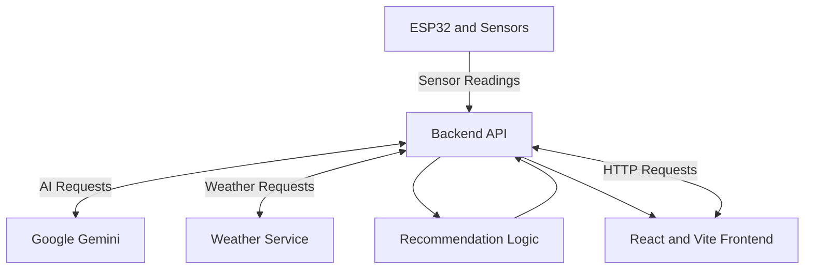

# 🌱 AI Smart Irrigation System

### Intelligent Irrigation • IoT • Weather Intelligence • Gemini AI

An AI-assisted smart irrigation platform designed to help monitor agricultural conditions, understand environmental data, and support informed irrigation decisions.

<!-- Replace YOUR_GITHUB_USERNAME with your GitHub username -->


---

## 📖 Table of Contents

- [Overview](#-overview)
- [Problem Statement](#-problem-statement)
- [Project Objectives](#-project-objectives)
- [Key Features](#-key-features)
- [Technology Stack](#-technology-stack)
- [System Architecture](#-system-architecture)
- [Project Structure](#-project-structure)
- [Installation and Setup](#-installation-and-setup)
- [Environment Configuration](#-environment-configuration)
- [API Documentation](#-api-documentation)
- [How It Works](#-how-it-works)
- [Security and Limitations](#-security-and-limitations)
- [Future Enhancements](#-future-enhancements)
- [Contributing](#-contributing)
- [Acknowledgements](#-acknowledgements)

## 🌿 Overview

The **AI Smart Irrigation System** is an academic project that explores the use of IoT, environmental data, weather information, and artificial intelligence to support smarter irrigation management.

The platform is designed to bring sensor readings and useful agricultural insights into a single web interface. Users can monitor available environmental readings, maintain basic farm information, access weather information, and interact with an AI assistant for irrigation-related guidance.

The project follows a frontend-backend architecture, making it possible to connect a web dashboard with sensor hardware and external services as the system develops.

## 🎯 Problem Statement

Traditional irrigation decisions may rely on fixed schedules or manual observation. These approaches can overlook changing soil moisture, rainfall, temperature, and other environmental conditions.

A smarter approach can combine available sensor readings with weather information and contextual recommendations to help users make better-informed watering decisions.

This project explores that approach through a web-based irrigation platform with AI-assisted guidance.

## 🚀 Project Objectives

- Develop a web interface for viewing irrigation-related information.
- Create backend APIs to receive and serve sensor readings.
- Integrate weather information for environmental context.
- Provide irrigation recommendations based on available data.
- Integrate Google Gemini for an agricultural question-and-answer assistant.
- Maintain a farm profile containing basic crop and soil information.
- Establish a foundation for future ESP32-based hardware integration.

## ✨ Key Features

### 📊 1. Sensor Data Monitoring

Designed to work with irrigation-related readings such as:

- Soil moisture sensor value
- Temperature
- Relative humidity
- Rain sensor value
- Light sensor reading
- Water flow reading

Actual readings depend on whether hardware is connected or demonstration data is being used.

### 🌦️ 2. Weather Information

The weather module is designed to retrieve current environmental conditions and forecast information for a selected location.

Weather information can provide additional context when considering irrigation needs.

### 💧 3. Smart Irrigation Recommendations

The recommendation module evaluates available sensor readings and provides irrigation-related guidance.

The recommendations should be validated against actual sensor calibration, crop requirements, soil conditions, and local weather before making real irrigation decisions.

### 🤖 4. Gemini AI Assistant

The AI assistant is designed to answer questions related to irrigation, soil moisture, weather context, and general agricultural practices.

The assistant uses a backend integration with Google Gemini when the required API configuration is available.

### 🌾 5. Farm Profile Management

The farm profile is designed to maintain basic information, including:

- Crop type
- Soil type
- Farm size
- Farm location

This information can help provide more relevant irrigation guidance.

### 🔌 6. Backend API and WebSocket Support

The backend provides an interface for frontend communication and sensor data processing. WebSocket support can be used for real-time communication where implemented.

The availability of individual routes and live hardware updates depends on the current backend configuration.

## 🛠️ Technology Stack

| Technology | Purpose |
|---|---|
| React.js | Frontend user interface |
| Vite | Frontend development server and build tooling |
| JavaScript | Application logic |
| Node.js | Backend runtime |
| Express.js | HTTP API development |
| Google Gemini | AI assistant integration |
| Weather API | Weather data retrieval |
| WebSocket | Real-time communication support |
| ESP32 | Intended hardware integration |
| Soil and environmental sensors | Environmental data collection |
| Git and GitHub | Version control and collaboration |

## 🏗️ System Architecture

The system is organized into frontend, backend, external services, and a planned hardware data source.



*Note: The diagram represents the intended system architecture. Actual hardware connectivity and each service integration depend on the current implementation.*

### Architecture Components

**Frontend:** Displays sensor information, farm details, weather information, recommendations, and the AI assistant interface.

**Backend:** Handles API requests, processes available sensor readings, and communicates with configured external services.

**AI Service:** Provides AI-generated responses through Google Gemini when correctly configured.

**Weather Service:** Supplies weather information for the selected location.

**Hardware Layer:** Intended to supply live readings from the ESP32 and connected sensors.

## 📁 Project Structure

```text
AI-Smart-Irrigation/
├── frontend/
│   ├── src/
│   │   └── App.jsx
│   ├── package.json
│   ├── package-lock.json
│   └── vite.config.js
│
├── backend/
│   ├── server.js
│   ├── package.json
│   ├── package-lock.json
│   └── .env                 # Local secrets; do not commit
│
├── .gitignore                 
└── README.md
```

*This is a representative structure. Your actual repository may contain additional files and folders.*

## ⚙️ Installation and Setup

### Prerequisites

Install the following:

- [Node.js](https://nodejs.org/)
- npm, included with Node.js
- [Git](https://git-scm.com/)
- [Visual Studio Code](https://code.visualstudio.com/) or another code editor

A Google Gemini API key is required for AI-powered responses. Weather integration may require internet access and depends on the configured weather service.

### Step 1: Clone the Repository


```bash
git clone <https://github.com/neha-1806/AI-Smart-Irrigation.git>
cd AI-Smart-Irrigation
```

### Step 2: Install Backend Dependencies

```bash
cd backend
npm install
```

### Step 3: Configure Environment Variables

Create a `.env` file inside the backend directory and add the variables required by your current backend implementation.

Example:

```env
PORT=3000
GEMINI_API_KEY=your_gemini_api_key
```

The environment variable names must match those referenced in your backend code.

**Never commit your real API key to GitHub.**

### Step 4: Start the Backend

Use the start command defined in `backend/package.json`. If the file does not define a start script, you can start the server with:

```bash
node server.js
```

The expected local backend address is:

```text
http://localhost:3000
```

### Step 5: Install Frontend Dependencies

Open another terminal from the project root:

```bash
cd frontend
npm install
```

### Step 6: Start the Frontend

```bash
npm run dev
```

Open the local address displayed by Vite, usually:

```text
http://localhost:5173
```

Keep the backend and frontend running in separate terminals.

## 🔌 API Documentation

The following table describes the intended API interface. Confirm each route against the current `backend/server.js` before treating it as a fully implemented endpoint.

| Method | Endpoint | Purpose |
|---|---|---|
| GET | `/` | Check backend availability |
| GET | `/api/sensor-data` | Retrieve sensor readings |
| POST | `/api/sensor-data` | Submit sensor readings |
| GET | `/api/farm-profile` | Retrieve farm information |
| POST | `/api/farm-profile` | Update farm information |
| GET | `/api/weather` | Retrieve weather information |
| GET | `/api/smart-recommendation` | Retrieve irrigation guidance |
| POST | `/api/chat` | Submit a question to the AI assistant |

### Example: Submit Sensor Data

Example request body:

```json
{
  "soil": 2850,
  "temperature": 30,
  "humidity": 62,
  "rain": 0,
  "ldr": 1,
  "flow": 15
}
```

Example request:

```bash
curl -X POST http://localhost:3000/api/sensor-data \
  -H "Content-Type: application/json" \
  -d "{\"soil\":2850,\"temperature\":30,\"humidity\":62,\"rain\":0,\"ldr\":1,\"flow\":15}"
```

The exact response format depends on the backend implementation.

### Example: Ask the AI Assistant

Example request body:

```json
{
  "question": "How can I improve soil moisture management?"
}
```

Example request:

```bash
curl -X POST http://localhost:3000/api/chat \
  -H "Content-Type: application/json" \
  -d "{\"question\":\"How can I improve soil moisture management?\"}"
```

AI responses require a working Gemini integration and valid API configuration.

## 🔄 How It Works

1. **Data Collection:** Sensor readings are supplied by connected hardware or a configured data source.
2. **Backend Processing:** The backend receives requests and makes the available data accessible through API routes.
3. **Weather Retrieval:** The weather module obtains environmental information for the selected location.
4. **Recommendation Generation:** The recommendation logic uses available readings to produce irrigation guidance.
5. **AI Interaction:** Users can ask agriculture-related questions through the Gemini-powered assistant.
6. **Dashboard Display:** The frontend presents the available information to the user.

## 🔐 Security and Limitations

- Store API credentials in environment variables.
- Add `.env` to `.gitignore`.
- Never expose private API keys in frontend code or public commits.
- Validate incoming sensor readings before using them for decisions.
- Configure appropriate CORS rules and authentication before public deployment.
- Check sensor calibration before interpreting raw readings as actual soil moisture.
- Treat AI-generated guidance as assistance, not a substitute for agricultural expertise.
- Demo data, if used, must not be presented as live hardware readings.

## 🔮 Future Enhancements

- Live ESP32 sensor integration.
- Automated pump control using a relay and appropriate safety mechanisms.
- Crop-specific and soil-specific recommendations.
- Persistent database storage for sensor readings and farm profiles.
- Historical data visualization and irrigation trends.
- Real-time dashboard updates through WebSockets.
- Weather-based irrigation scheduling.
- Improved alerts for rainfall, low moisture, and unusual readings.
- More robust AI recommendations using validated sensor and weather data.
- Deployment to a suitable cloud platform.

## 🤝 Contributing

Contributions from project teammates are welcome.

1. Discuss the proposed change with the project team.
2. Create a separate branch for the change.
3. Make focused changes and test them locally.
4. Submit a pull request describing the changes.
5. Review the changes before merging them.

Please avoid committing API keys, private credentials, or local environment files.

## 🙏 Acknowledgements

- Google Gemini for AI capabilities.
- The providers of the weather service used by the project.
- The open-source React, Vite, Node.js, and Express communities.

---

**AI Smart Irrigation System** — exploring how IoT, weather data, and artificial intelligence can support smarter agricultural water management.
